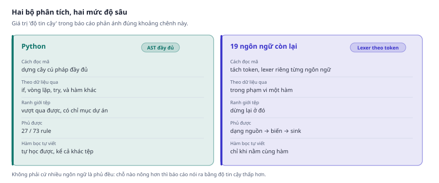
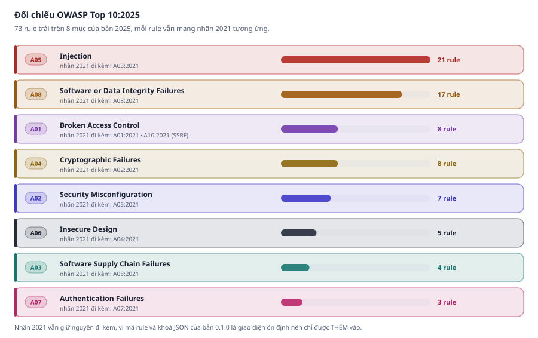
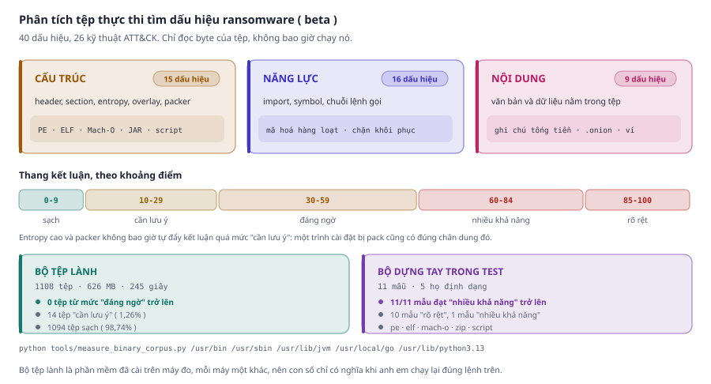

<div align="center">

# 🛡️ Fortress Scan

**Soi mã nguồn tìm lỗ hổng bằng cách lần theo đường đi của dữ liệu.**
Giao diện và báo cáo **hoàn toàn bằng tiếng Việt** cho anh em.

[](CHANGELOG.md)
[](LICENSE)
[](https://www.python.org/)
[](pyproject.toml)

[](#-73-rule-trên-35-họ-lỗ-hổng)
[](#-73-rule-trên-35-họ-lỗ-hổng)
[](#-một-lượt-quét-đi-qua-sáu-bước)

</div>

---

Fortress Scan đọc mã của anh em mà **không chạy nó**. Công cụ đánh dấu chỗ dữ liệu của người ngoài
đi vào ( tham số request, body, header, `argv` ), lần theo nó qua từng phép gán, phép nối chuỗi,
lời gọi hàm, và chỉ báo khi nó tới được chỗ nguy hiểm ( câu SQL, lệnh shell, `eval`, đường dẫn
tệp ) mà chưa qua bước làm sạch nào. Mỗi phát hiện in kèm **cả đường đi**, nên anh em tự kiểm lại
trong vài giây thay vì phải tin mù.

Ngoài lỗ hổng trong mã, công cụ còn soi điểm yếu cấu hình ( mật mã đã bị phá, tắt TLS, secret viết
cứng ), dấu vết của một vụ xâm nhập đã xảy ra ( webshell, cron lạ, khoá SSH cài cửa hậu ), và tệp
thực thi mang dấu hiệu ransomware ( beta ).

<table align="center">
<tr>
<td align="center"><b>73</b><br/><sub>rule</sub></td>
<td align="center"><b>35</b><br/><sub>họ lỗ hổng</sub></td>
<td align="center"><b>22</b><br/><sub>ngôn ngữ</sub></td>
<td align="center"><b>0</b><br/><sub>phụ thuộc ngoài</sub></td>
</tr>
</table>

---

## 🎯 Mục đích

Đây là **dự án cá nhân**, viết ra vì mình mong anh em dev Việt Nam có một công cụ **tiếng Việt**
để soi lại code **trước khi đưa lên production**, mà không phải nhờ người khác pentest hay đốt token
quý giá của AI agent chỉ để quét lại.

Nó là một lớp rà soát thêm bên cạnh việc tự review: không cần cấu hình, chỉ ra chỗ đáng ngờ kèm
bằng chứng, còn sửa thế nào vẫn là quyền của anh em.

> [!WARNING]
> Kết quả là **gợi ý**, không phải phán quyết. Báo cáo sạch không chứng minh mã an toàn, và sửa
> theo gợi ý chưa chắc đã vá hết. Công cụ không thấy được hàm bọc nằm trong thư viện ngoài, dữ liệu
> bẩn lưu vào CSDL rồi đọc ra dùng lại, hay lỗi logic nghiệp vụ.

---

## ⚡ Cài đặt và chạy

Chỉ cần Python 3.9 trở lên, không cài thêm thư viện nào.

```bash
git clone https://github.com/fortress07/fortress-scan
cd fortress-scan
pip install -e .
```

```bash
fscan ./du-an-cua-toi                  # quét cả thư mục
fscan ./du-an-cua-toi -v               # kèm đường đi dữ liệu và cách sửa
fscan . --min-severity high            # chỉ xem lỗi nặng
fscan . -f sarif -o ket-qua.sarif      # xuất cho GitHub code scanning ( có cả json, markdown )
fscan --explain FSB-SQL-001            # vì sao rule này là lỗ hổng, sửa thế nào
fscan binary ./thu-muc-tai-ve          # soi tệp thực thi tìm dấu hiệu ransomware ( beta )
```

Shell báo không tìm thấy `fscan` thì thay bằng `python -m fortress_scan`. Kết quả trông như thế này:

```
routes.py
   CRIT  12:4  Dữ liệu không tin cậy được nối thẳng vào câu lệnh SQL
        tham số truy vấn HTTP chạy tới cursor.execute() mà chưa được vô hiệu hóa
        FSB-SQL-001 | độ tin cậy high | CWE-89
        cursor.execute(f"SELECT * FROM users WHERE name = '{name}'")
        đường đi của dữ liệu:
          dòng 10 tham số truy vấn HTTP đi vào từ đây
          dòng 10 chảy vào biến name
          dòng 12 chạy tới cursor.execute()
```

**Gắn vào CI.** Mã thoát là `0` khi sạch, `1` khi có phát hiện, `2` khi gõ sai lệnh, `3` khi lỗi
nội bộ. Muốn pull request chỉ đỏ vì đúng phần vừa sửa:

```bash
git diff --unified=0 origin/main... > thay-doi.patch
fscan . --diff thay-doi.patch --fail-on-confidence high
```

**Quét mã của người khác.** Chú thích `fortress-scan: ignore`, `.fortress-scan.json`,
`.fortress-scanignore` và `.gitignore` đều nằm trong chính mã được quét, nên người viết mã dùng được
chúng để giấu phát hiện. Đọc mã lạ thì tắt cả bốn:

```bash
fscan <duong-dan> --no-inline-suppressions --no-config --no-ignore-files --no-vcs-ignore
```

---

## 🧠 Cách hoạt động

### 🔎 Lần theo dữ liệu, không dò từ khoá

<picture>
  <source media="(prefers-color-scheme: dark)" srcset="docs/img/taint-flow-dark.svg">
  
</picture>

Thấy `cursor.execute(sql)` chưa đủ để báo, phải thấy `sql` được ghép từ `request.args`. Bộ khử độc
cũng phải đúng loại: `html.escape` làm sạch dữ liệu cho HTML nhưng không cứu được một câu SQL, nên
vết bẩn vẫn còn khi dữ liệu đó chạy tới `execute`. Rẽ nhánh thì chỉ cần một nhánh bẩn là đủ để
cảnh báo.

### 🔒 Một lượt quét đi qua sáu bước

<picture>
  <source media="(prefers-color-scheme: dark)" srcset="docs/img/pipeline-dark.svg">
  
</picture>

Bước đầu tiên là khoá chính tiến trình đang chạy: `socket`, `subprocess`, `os.system` bị vá đè
trước khi tệp nào được mở. Mã được quét chỉ được phân tích cú pháp, không bao giờ được import hay
chạy, công cụ không ghi tệp nào trừ khi anh em yêu cầu bằng `-o` hay `--write-baseline`, và
không mở kết nối mạng nào.
Nhờ vậy anh em trỏ nó vào mã lạ mà không cần dựng sandbox riêng.

### 🧭 Hai mức độ sâu

<picture>
  <source media="(prefers-color-scheme: dark)" srcset="docs/img/analyzers-dark.svg">
  
</picture>

Python được dựng cây cú pháp đầy đủ nên theo được dữ liệu qua hàm, lớp và tệp khác. Các ngôn ngữ
còn lại đọc theo token; riêng JavaScript/TypeScript, Java và Go có thêm chỉ mục dự án nên cũng đi
xuyên tệp, qua template và mapper SQL. C, C++, Objective-C có thêm bộ đọc cấu trúc riêng để bắt lỗi
bộ nhớ: tràn bộ đệm, dùng con trỏ sau khi giải phóng, giải phóng hai lần, chuỗi định dạng. Chỗ nào
phân tích nông hơn, báo cáo nói ra bằng độ tin cậy thấp hơn.

**Ngôn ngữ quét được:** Python, JavaScript, TypeScript, Java, Kotlin, Scala, Groovy ( cả
Jenkinsfile ), Go, C#, PHP, Ruby, Rust, Swift, Dart, Elixir, Lua, Perl, PowerShell, Shell, C, C++,
Objective-C, cùng workflow GitHub Actions và `package.json`.

### 📋 73 rule trên 35 họ lỗ hổng

<picture>
  <source media="(prefers-color-scheme: dark)" srcset="docs/img/owasp-2025-dark.svg">
  
</picture>

Mỗi rule có một mẫu mã thật làm nó bắn trong bộ test, phần lớn kèm một mẫu an toàn để chắc nó không
kêu bừa. Nhãn OWASP 2025 đi kèm nhãn 2021 trong cả JSON lẫn SARIF.

<details>
<summary><b>Các họ rule ( bấm để mở )</b></summary>

<br/>

| Nhóm | Họ rule |
| :--- | :--- |
| Injection | `FSB-SQL` · `FSB-CMD` · `FSB-EXEC` · `FSB-TMPL` · `FSB-EL` · `FSB-LDAP` · `FSB-XPATH` · `FSB-NOSQL` · `FSB-XSS` · `FSB-HDR` · `FSB-REFL` · `FSB-IMPORT` |
| Kiểm soát truy cập | `FSB-PATH` · `FSB-SSRF` · `FSB-REDIR` · `FSB-ACCESS` |
| Toàn vẹn dữ liệu | `FSB-DESER` · `FSB-MASS` · `FSB-PROTO` · `FSB-UNI` ( Trojan Source, ký tự ẩn ) |
| Chuỗi cung ứng và CI | `FSB-SUP` ( `package.json` ) · `FSB-CI` ( workflow GitHub Actions ) |
| Mật mã và xác thực | `FSB-CRYPTO` · `FSB-TLS` · `FSB-SECRET` · `FSB-JWT` |
| Cấu hình | `FSB-XML` ( XXE ) · `FSB-CORS` · `FSB-COOKIE` · `FSB-DEBUG` · `FSB-PERM` · `FSB-TMP` |
| Bộ nhớ C / C++ | `FSB-MEM` |
| Truy vết xâm nhập | `FSB-IR` |

Xem đủ bằng `fscan --list-rules`.

</details>

### 🚨 Hai việc ngoài lỗ hổng trong mã

**Truy vết xâm nhập ( `FSB-IR` ).** Các rule khác trả lời "mã này có thể bị khai thác", còn họ này
trả lời "đã có ai vào đây chưa". Công cụ đọc cả những tệp không ai coi là mã nguồn ( `crontab`, unit
systemd, `authorized_keys`, `sudoers`, `ld.so.preload`, `.htaccess` ) vì đó là nơi kẻ tấn công cắm
cơ chế trụ lại. Kết luận dựa trên cả tệp chứ không trên một dòng, nên một lời gọi `eval` bình thường
trong controller không bị gọi là webshell.

**Tệp thực thi ( beta ).** `fscan binary` đọc thẳng byte của PE, ELF, Mach-O, JAR, PyInstaller và
script, tìm dấu hiệu ransomware: ghi chú đòi tiền, lệnh xoá bản sao bóng, chuỗi năng lực mã hoá
hàng loạt, ví tiền mã hoá, kể cả chuỗi bị che bằng XOR. Tệp không bao giờ được chạy, giải nén ra đĩa
hay gửi đi đâu.

<picture>
  <source media="(prefers-color-scheme: dark)" srcset="docs/img/binary-triage-dark.svg">
  
</picture>

Đây là công cụ **phân loại nhanh** cho người phòng thủ: nó thu hẹp một đống tệp xuống vài tệp đáng
mở ra xem và nói rõ vì sao. Nó không dịch ngược lệnh máy, không bung tệp đã pack, nên không thay
được một buổi phân tích ngược tử tế hay một phần mềm diệt virus.

---

## 💚 Lời cảm ơn

Fortress Scan được viết bởi **[fortress07](https://github.com/fortress07)**, là dự án đầu tay của
mình. Dự án có **sự hỗ trợ của AI** ( Claude ) trong việc tham khảo cách triển khai, sinh mã cho các
bộ phân tích, viết test và soạn tài liệu. Hướng đi, yêu cầu, quyết định thiết kế và việc kiểm thử
đều do mình điều hướng và rà soát. Mình ghi rõ điều này vì người dùng có quyền biết mã họ đang chạy
được tạo ra như thế nào.

Cảm ơn anh em đã dành thời gian đọc tới đây và tin dùng Fortress Scan. Nếu công cụ giúp ích được
cho anh em, một ngôi sao ⭐ trên GitHub là nguồn động viên rất lớn đối với mình.

Gặp lỗi hay có góp ý thì anh em báo mình qua mail **vophuvinh15012007@gmail.com**, kèm giúp mình
**phiên bản công cụ**, **hệ điều hành** và **một đoạn mã nhỏ tái hiện được lỗi** để mình sửa nhanh
hơn nhé. Mình đọc và phản hồi tất cả, chỉ là có thể hơi chậm.

## 📄 Giấy phép

[MIT](LICENSE), dùng tự do cho cả mục đích cá nhân và thương mại.

Không được dùng để bán, cung cấp cho các dịch vụ trả phí hoặc các hành vi dùng cho mục đích xấu.
